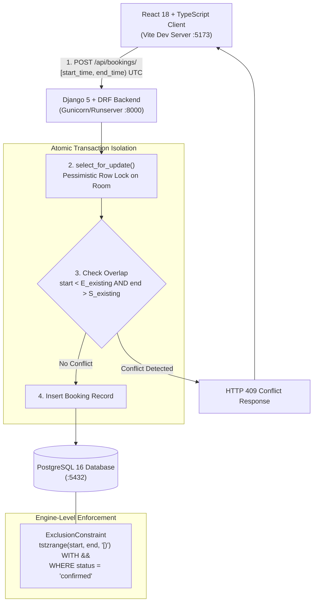

# Enterprise Meeting Room Booking System


A high-reliability meeting room booking platform engineered to eliminate scheduling conflicts and race conditions. Built with Django REST Framework, PostgreSQL 16, and React 18 with TypeScript.

---

## Architecture Overview

The system employs a multi-tier defense against double bookings, combining engine-level database constraints, pessimistic row locks, serializer boundary checks, and responsive UI feedback:



---

## Data Models & Constraints

### 1. `Room` Model
Represents a physical bookable conference room or meeting space.

| Field | Type | Required | Constraints & Validation |
| :--- | :--- | :---: | :--- |
| `id` | `AutoField` | Auto | Primary key, integer |
| `name` | `CharField(100)` | Yes | `unique=True`, indexed, case-preserved |
| `location` | `CharField(150)` | Yes | Physical location (e.g., floor, wing) |
| `capacity` | `PositiveIntegerField` | Yes | Minimum seats $\ge 1$, indexed for range queries |

---

### 2. `Booking` Model
Represents a scheduled reservation for a specific room over a half-open temporal interval $[S, E)$.

| Field | Type | Required | Constraints & Validation |
| :--- | :--- | :---: | :--- |
| `id` | `AutoField` | Auto | Primary key, integer |
| `room` | `ForeignKey(Room)` | Yes | `on_delete=CASCADE`, `related_name='bookings'` |
| `customer_name` | `CharField(150)` | Yes | Full name of the organizer |
| `customer_email` | `EmailField` | Yes | Valid email format |
| `start_time` | `DateTimeField` | Yes | UTC ISO 8601; must be in the future; 15-min boundary aligned |
| `end_time` | `DateTimeField` | Yes | UTC ISO 8601; strictly $> \text{start}$; 15-min boundary aligned |
| `status` | `CharField(10)` | Yes | Enum: `'confirmed'`, `'cancelled'` (defaults to `'confirmed'`) |
| `created_at` | `DateTimeField` | Auto | UTC timestamp on record creation (`auto_now_add=True`) |

#### Database-Level Integrity Rules
- **`CheckConstraint` (`booking_start_time_before_end_time`)**:  
  Enforces `CHECK (start_time < end_time)` at the PostgreSQL storage engine level.
- **`ExclusionConstraint` (`exclude_overlapping_confirmed_bookings`)**:  
  Enforces `EXCLUDE USING GIST (tstzrange(start_time, end_time, '[)') WITH &&, room_id WITH =)` conditional on `status = 'confirmed'`. Prevents overlapping reservations even if application processes crash or bypass serializers.

---

## Key Engineering Decisions

### 1. Half-Open Interval Scheduling
Reservations operate strictly on **half-open intervals**: `[start_time, end_time)`. A meeting occupies the room from `start_time` up to, but not including, `end_time`.
* Two intervals $[S_1, E_1)$ and $[S_2, E_2)$ overlap if and only if:
  $$S_1 < E_2 \quad \text{AND} \quad E_1 > S_2$$
* Back-to-back reservations (e.g., `10:00–11:00` and `11:00–12:00`) are accepted seamlessly without false positive collisions.

### 2. Concurrency & Race Condition Prevention
* **Pessimistic Row Locking**: All booking creation mutations execute within `transaction.atomic()`, acquiring an exclusive row lock on the target room via `Room.objects.select_for_update().get(pk=room_id)` to eliminate Time-of-Check to Time-of-Use (TOCTOU) race conditions.
* **Database Exclusion Constraint**: PostgreSQL enforces physical integrity via an `ExclusionConstraint` on `tstzrange(start_time, end_time, '[)')` overlapping confirmed bookings for the same room.
* **Idempotent Cancellation**: Cancelling a reservation (`PATCH /api/bookings/<id>/cancel/`) transitions its status to `cancelled` and immediately frees the slot. Subsequent cancellations return `400 Bad Request`.

### 3. Strict 15-Minute Slot Alignment & Duration Bounds
* **Quarter-Hour Boundary Enforcement**: Both `start_time` and `end_time` must align strictly to `:00`, `:15`, `:30`, or `:45` minute marks with 0 seconds and 0 microseconds.
* **Duration Constraints**: Minimum booking duration is 15 minutes; maximum single booking duration is 24 hours. Validated at both the serializer layer and frontend modal with quick duration chips (`15m`, `30m`, `45m`, `1h`, `1.5h`, `2h`).

### 4. Canceled Meeting Lifecycle (Approach 2: Segmented Status Filtering)
* **Pristine Default View**: The Bookings List view defaults to active meetings (`status=confirmed`), eliminating visual clutter during operational room scheduling.
* **Segmented Status Pills**: Users can toggle between `Active (n)`, `Cancelled (n)`, and `All (n)` with real-time counter badges.
* **Non-Destructive Audit Trail**: Cancelled bookings retain full metadata, rendering with 0.72 opacity, strikethrough customer names, and `cancelled` badges.
* **Reassurance Feedback**: Cancelling an active meeting immediately displays an alert toast with a 1-click `View in Cancelled →` shortcut.

### 5. Google Calendar-Style 24-Hour Day Schedule View
* **24-Hour Timeline**: Interactive visual canvas displaying all rooms in parallel lanes across the full 24-hour day.
* **Drag-to-Select Slot Creation**: Click-and-drag directly on any room's timeline lane to select time intervals, automatically populating the booking modal with 15-minute aligned bounds.
* **Auto-Scroll to Earliest Meeting**: On load or date navigation, the timeline automatically scrolls to 90 minutes before the first scheduled meeting of the day.
* **Temporal Projection Anchor (`focalUtcRef`)**: Preserves the focal UTC timestamp across dynamic timezone shifts, automatically projecting the date so meetings do not vanish across midnight boundaries.

### 6. Global Multi-Timezone Invariance
* **Universal UTC Storage**: All timestamps are validated and stored in PostgreSQL strictly as UTC ISO 8601 (`YYYY-MM-DDTHH:MM:SSZ`).
* **Interactive Canonical Timezone Selector**: Users can switch viewing timezones on the fly (e.g., UTC, America/New_York, Europe/London, Asia/Tokyo). All meeting cards, timeline blocks, and modal pickers re-project into the chosen timezone instantly.

---

## Quickstart & Docker Compose Workflow

### Prerequisites
* [Docker Desktop](https://www.docker.com/products/docker-desktop/) (Engine 24+, Compose v2+)

### 1. Clone & Start Containers
```bash
git clone https://github.com/juweriya1/meeting-room-booking.git
cd meeting-room-booking

# Build images and start Postgres, Django backend, and React frontend
docker compose up --build -d
```

The startup script (`backend/entrypoint.sh`) automatically:
1. Waits for PostgreSQL to accept socket connections on port 5432.
2. Applies all Django database migrations (`python manage.py migrate`).
3. Seeds 4 enterprise meeting rooms via `python manage.py seed_rooms`.

---

### 2. Environment Configuration

All environment variables are pre-configured in `docker-compose.yml` for zero-configuration startup:

| Variable | Default Value | Description |
| :--- | :--- | :--- |
| `POSTGRES_DB` | `meeting_room_db` | PostgreSQL target database name |
| `POSTGRES_USER` | `postgres` | PostgreSQL superuser username |
| `POSTGRES_PASSWORD` | `postgrespassword` | PostgreSQL superuser password |
| `DB_HOST` | `db` | Docker network hostname for database container |
| `DB_PORT` | `5432` | PostgreSQL internal network port |
| `DEBUG` | `1` | Django debug mode flag |
| `VITE_API_BASE_URL` | `http://localhost:8000` | Backend API URL proxied by Vite development server |

---

### 3. Service Access Endpoints

| Service | Access URL | Purpose |
| :--- | :--- | :--- |
| **Frontend Dashboard** | [http://localhost:5173](http://localhost:5173) | 2-Column dashboard, Day Schedule timeline, modal |
| **Backend REST API** | [http://localhost:8000/api/](http://localhost:8000/api/) | DRF browsable API root |
| **PostgreSQL Database** | `localhost:5432` | Database `meeting_room_db` (user: `postgres`) |

---

## REST API Reference

### Endpoints

| Method | Endpoint | Description | Status Codes |
| :--- | :--- | :--- | :--- |
| `GET` | `/api/rooms/` | List all rooms. Filter via `?search=<name>&capacity=<int>` | `200 OK` |
| `GET` | `/api/rooms/<id>/` | Retrieve room details by ID | `200 OK`, `404 Not Found` |
| `GET` | `/api/bookings/` | List bookings. Filter via `?room=<id>&status=confirmed\|cancelled` | `200 OK` |
| `POST` | `/api/bookings/` | Create a new reservation $[S, E)$ under atomic row lock | `201 Created`, `400 Bad Request`, `409 Conflict` |
| `GET` | `/api/bookings/<id>/` | Retrieve booking details by ID | `200 OK`, `404 Not Found` |
| `PATCH` | `/api/bookings/<id>/cancel/` | Cancel an active booking and release the slot | `200 OK`, `400 Bad Request`, `404 Not Found` |

---

### Request & Response Contracts

#### 1. Create Booking (Success: `201 Created`)
**Request `POST /api/bookings/`**:
```json
{
  "room": 1,
  "customer_name": "Jane Doe",
  "customer_email": "jane@example.com",
  "start_time": "2026-11-17T10:00:00Z",
  "end_time": "2026-11-17T11:00:00Z"
}
```

**Response `201 Created`**:
```json
{
  "id": 1,
  "room": {
    "id": 1,
    "name": "Phoenix",
    "location": "Floor 1 - West Wing",
    "capacity": 4
  },
  "customer_name": "Jane Doe",
  "customer_email": "jane@example.com",
  "start_time": "2026-11-17T10:00:00Z",
  "end_time": "2026-11-17T11:00:00Z",
  "status": "confirmed",
  "created_at": "2026-11-16T02:00:00.123456Z"
}
```

#### 2. Slot Overlap (Conflict: `409 Conflict`)
When a booking conflicts with an existing confirmed reservation on the same room:
```json
{
  "error": "This room is already booked for the requested time slot."
}
```

#### 3. Client Validation Error (Bad Request: `400 Bad Request`)
When input constraints are violated (e.g. chronological order, alignment, duration):
```json
{
  "end_time": [
    "end_time must be strictly after start_time."
  ]
}
```

---

## Automated Verification & Test Harness

### Backend Test Suite (Django & PostgreSQL)
Execute all 21 automated tests directly inside the running container:
```bash
docker compose exec backend python manage.py test bookings --verbosity=2
```

### Test Coverage Highlights (21/21 Passing in 0.22s):

#### 1. Concurrency & Race Conditions (`BookingConcurrencyTests`)
- `test_concurrent_booking_race_condition`: Fires 3 simultaneous threads via `ThreadPoolExecutor` targeting the identical room and time slot; asserts exactly one `201 Created` and two `409 Conflict` under PostgreSQL `select_for_update` row locks.

#### 2. Temporal Logic & Interval Overlap Defense
- `test_overlap_rejection`: Rejects partial and enclosing overlaps with `409 Conflict` and `"already booked"` message.
- `test_exact_duplicate_rejection`: Rejects identical interval requests with `409 Conflict`.
- `test_adjacent_bookings_accepted`: Validates strict half-open interval boundaries $[S, E)$; confirms back-to-back meetings (`10:00–11:00` and `11:00–12:00`) are accepted with `201 Created`.

#### 3. Input Validation & Quarter-Hour Bounds
- `test_start_must_be_before_end`: Enforces chronological validity with `400 Bad Request`.
- `test_minimum_duration_15_minutes_rejected`: Rejects reservations shorter than 15 minutes with `400 Bad Request`.
- `test_minimum_duration_15_minutes_accepted`: Confirms 15-minute aligned reservations with `201 Created`.
- `test_unaligned_start_time_rejected`: Rejects start times not on `:00/:15/:30/:45` marks with `400 Bad Request`.
- `test_unaligned_end_time_rejected`: Rejects end times not on `:00/:15/:30/:45` marks with `400 Bad Request`.
- `test_maximum_duration_exceeded_rejected`: Rejects reservations exceeding 24 hours with `400 Bad Request`.

#### 4. Lifecycle, Cancellation & Slot Reclamation
- `test_cancelled_booking_frees_slot`: Confirms immediate slot availability upon cancellation and allows re-booking.
- `test_cancel_already_cancelled_booking_rejected`: Asserts re-cancelling a cancelled booking returns `400 Bad Request`.
- `test_filter_by_status_confirmed`: Confirms `?status=confirmed` returns active bookings only.
- `test_filter_by_status_cancelled`: Confirms `?status=cancelled` returns cancelled bookings only.
- `test_filter_by_status_invalid_value_ignored`: Confirms invalid status values do not cause server errors and return all records.

#### 5. Room Directory & Query API (`RoomApiTests`)
- `test_list_rooms_ordered_by_name`: Asserts alphabetical sorting of room entities.
- `test_search_rooms_case_insensitive`: Confirms `?search=al` matches room names case-insensitively.
- `test_filter_rooms_by_capacity`: Confirms `?capacity=10` filters rooms with minimum capacity $\ge 10$.
- `test_filter_rooms_invalid_capacity_ignored`: Asserts invalid non-numeric capacity query values are safely ignored.
- `test_retrieve_room_by_id`: Confirms individual room retrieval by ID.
- `test_retrieve_room_nonexistent_returns_404`: Confirms nonexistent room IDs return `404 Not Found`.

---

### Frontend Static Analysis & Type Rig
```bash
cd frontend
npm run lint   # Runs: tsc --noEmit (zero errors allowed)
npm run build  # Runs: tsc && vite build (production bundle, 46 modules transformed)
```

---

## UI Walkthrough & Screenshots

### 1. Two-Column Dashboard & Day Schedule View
The dashboard provides a room directory on the left and a toggle between the 24-hour visual Day Schedule timeline and the segmented Bookings List on the right.


### 2. Room Search & Capacity Filtering
Filter by room name and minimum capacity with debounced queries that maintain card mounting without layout flicker.


### 3. Booking Modal & 15-Minute Slot Alignment
Features quick-duration chips (`15m` through `2h`), timezone context card, and quarter-hour boundary alignment.


### 4. HTTP 409 Conflict Red Banner
When an overlapping reservation is attempted, the server rejects the request with HTTP 409 and the frontend renders an explicit red alert banner.


### 5. Cancellation & Slot Reclamation (Approach 2)
Cancelling a booking updates its status to `cancelled`, immediately frees the slot, and moves the meeting to the `Cancelled` filter tab with feedback toast.


### 6. Interactive Multi-Timezone Switching
Users can switch viewing timezones on the fly (e.g., UTC, America/Los_Angeles, Europe/London, Asia/Tokyo). All meeting cards, timeline blocks, and modal pickers adapt with localized timestamps.


---

## Project Structure

```text
meeting-room-booking/
├── AGENTS.md                  # System directive and architectural constitution
├── PROJECT_WALKTHROUGH.md     # Full architectural audit and technical walkthrough
├── docker-compose.yml         # Multi-container orchestration (db, backend, frontend)
├── backend/
│   ├── Dockerfile
│   ├── entrypoint.sh          # Auto-migration and database seed runner
│   ├── requirements.txt       # Frozen Python dependencies
│   ├── config/                # Django project settings and root routing
│   └── bookings/
│       ├── models.py          # Room, Booking models with PostgreSQL ExclusionConstraint
│       ├── views.py           # RoomViewSet, BookingViewSet with select_for_update & ?status=
│       ├── serializers.py     # RoomSerializer, BookingSerializer with 15-min validation
│       ├── urls.py            # API routing
│       ├── tests.py           # 21 automated business rule, concurrency, and room API tests
│       └── management/commands/seed_rooms.py # Idempotent room seeder
├── frontend/
│   ├── Dockerfile
│   ├── package.json           # React 18, TypeScript 5, Vite 5
│   ├── tsconfig.json          # Strict TypeScript compiler options
│   ├── vite.config.ts         # Vite server and backend proxy
│   └── src/
│       ├── types.ts           # Shared TypeScript interfaces & timezone projection helpers
│       ├── canonicalTimezones.ts # Curated IANA timezone registry with deduplicated offsets
│       ├── api.ts             # Native fetch client (no external HTTP libraries)
│       ├── App.tsx            # 2-column layout shell with timeline/list mode toggle
│       ├── index.css          # Design tokens and UI alert banners
│       └── components/        # Modular UI components (< 200 lines each):
│           ├── RoomCard.tsx             # Individual room card with booking action
│           ├── RoomList.tsx             # Debounced search & capacity filters
│           ├── BookingCard.tsx          # Booking card with cancel action & strikethrough
│           ├── BookingList.tsx          # Segmented status pills (Active/Cancelled/All) & toast
│           ├── BookingModal.tsx         # Modal presentation layer & quick chips
│           ├── useBookingForm.ts        # Custom hook for form validation & scheduling logic
│           ├── DayScheduleView.tsx      # 24h timeline orchestrator & scroll management
│           ├── DayScheduleHeader.tsx    # Calendar navigation (Prev/Today/Next) & date picker
│           ├── DayScheduleRow.tsx       # Individual room timeline row with hover guides
│           ├── ScheduleBookingBlock.tsx # High-contrast meeting block with localized tooltip
│           ├── TimezoneSelector.tsx     # Canonical timezone search & selector
│           └── scheduleUtils.ts         # Timeline math, palettes, and date helpers
└── docs/
    └── screenshots/           # End-to-end browser verification captures
```
